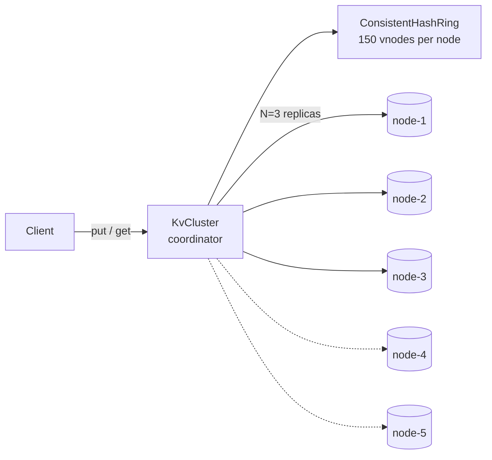

# Distributed Key-Value Store

An in-process simulation of a Dynamo / Cassandra style key-value store, written in plain Java 21. The "servers" are objects instead of separate processes, which lets me test the distributed behaviour (node crashes, stale replicas, rebalancing) deterministically in unit tests.

## Concepts covered

- **Consistent hashing with virtual nodes**: deciding which servers own a key, and moving as little data as possible when servers join or leave
- **Replication**: each key lives on N nodes
- **Tunable quorums (N, W, R)**: trading consistency against availability
- **Read repair**: replicas that missed a write get fixed when the key is read
- **Tombstones**: versioned deletes, so a stale replica can't bring a deleted key back
- **Rebalancing** when nodes are added or decommissioned

## Architecture



| Class | Role |
|---|---|
| `ConsistentHashRing` | `TreeMap<hash, node>`; preference list = first N distinct nodes clockwise from the key |
| `StorageNode` | A server's local map of `key -> VersionedValue`; can `crash()` and `recover()` |
| `VersionedValue` | Value + version; null value = tombstone |
| `KvCluster` | Coordinator: replication, quorums, read repair, rebalancing |

## Write and read path

**put(key, value)**
1. Assign a new version from a cluster-wide counter
2. Find the key's preference list (N nodes) on the ring
3. Send the write to all N; succeed once W of them acknowledge, otherwise `QuorumNotReachedException`

**get(key)**
1. Ask all N replicas
2. Need at least R answers
3. Return the value with the highest version
4. Push that value to any replica that answered with an older version (read repair)

With the defaults N=3, W=2, R=2 we have R + W > N, so every read overlaps the latest successful write on at least one node. The cluster keeps working with one replica of a key down, and refuses (instead of returning stale data) with two down.

| Setting | Behaviour |
|---|---|
| N=3, W=2, R=2 | Balanced, strongly consistent reads (default) |
| N=3, W=1, R=1 | Fastest, highest availability, reads can be stale |
| N=3, W=3, R=1 | Fast reads, any node failure blocks writes |

## Why virtual nodes

With one point per server, the ring slices are random sizes and one server can end up with 2-3x the keys of another. Placing each server 150 times evens that out. `ConsistentHashRingTest#virtualNodesBalanceTheLoad` checks that the busiest/least-busy ratio drops below 1.5.

## Demo output

```
Replicas per node (N=3): {node-1=11279, node-2=12913, node-3=12520, node-4=11993, node-5=11295}
Added node-6 -> 16.3% of keys changed primary owner (ideal: 16.7%), RebalanceReport[totalKeys=20000, replicasCopied=9736, replicasDropped=9736]
Replicas per node after: {node-1=9704, node-2=10633, node-3=10320, node-4=9989, node-5=9618, node-6=9736}

node-1 crashed. Replicas of user:42: [node-1, node-3, node-2]
Read with one replica down: updated-while-node-1-was-down
node-1 recovered, value on it now: updated-while-node-1-was-down (read repairs so far: 1)
```

Adding a 6th node moved 16.3% of the keys, almost exactly the ideal 1/6. With `hash(key) % nodeCount` nearly all of them would have moved.

## Running

```bash
mvn test
mvn compile && java -cp target/classes com.praveen.kvstore.Demo
```

## Simplifications (and what a real system does)

- **Last-write-wins with a global counter.** A real cluster has no shared counter. Dynamo uses vector clocks to detect concurrent writes and hands conflicting siblings to the client; Cassandra uses timestamps and accepts that clock skew can lose a write.
- **No hinted handoff.** If a replica is down, Dynamo writes to the next node with a "hint" and replays it later. Here the replica catches up through read repair or rebalancing.
- **No anti-entropy.** Keys that are never read stay stale until the next rebalance. Cassandra runs Merkle-tree repairs in the background for this.
- **Failed writes aren't rolled back.** If only 1 of 2 required acks arrives, that one replica still has the value. This matches Dynamo-style systems, where a failed write may or may not be visible later.
- **Sequential replica calls.** A real coordinator sends to all replicas in parallel and returns as soon as W/R respond.
